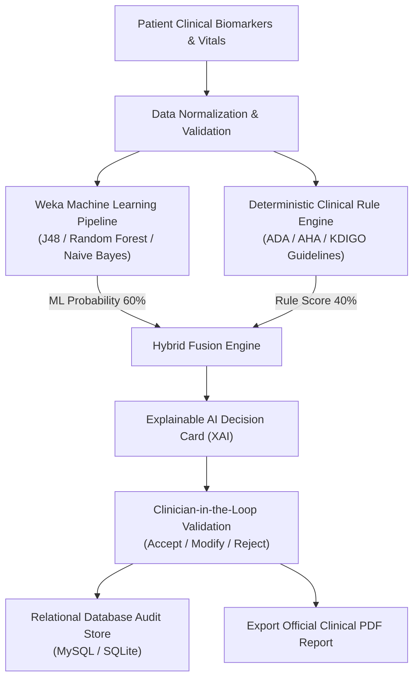

# 🏥 MediGuide AI — Explainable Hybrid AI Healthcare Decision Support System

[](https://www.oracle.com/java/)
[](https://openjfx.io/)
[](https://www.mysql.com/)
[](https://www.cs.waikato.ac.nz/ml/weka/)
[](https://itextpdf.com/)
[](LICENSE)

> **MediGuide AI** is an advanced **Explainable AI (XAI)** Clinical Decision Support System (CDSS) built in **Java 21** and **JavaFX**. It integrates **Weka Machine Learning algorithms** (*J48 Decision Tree, Random Forest, Naive Bayes* with 10-fold cross validation) and a **Deterministic Clinical Rule Engine** into a transparent, **weighted hybrid decision fusion architecture**.

---

## 📑 Table of Contents
- [System Architecture](#-system-architecture)
- [Core Features](#-core-features)
- [Explainable AI (XAI) Engine](#-explainable-ai-xai-engine)
- [Database Setup & Dataset (`Database.sql`)](#-database-setup--dataset-databasesql)
- [Prerequisites](#-prerequisites)
- [Installation & Quickstart](#-installation--quickstart)
- [Demo Credentials](#-demo-credentials)
- [Repository Structure](#-repository-structure)
- [Technology Stack](#-technology-stack)
- [Clinical Disclaimer](#-clinical-disclaimer)

---

## 🏛 System Architecture

The core of MediGuide AI is its **Transparent Hybrid Decision Fusion Engine**, fusing data-driven statistical ML inference with evidence-based clinical rules:



---

## ✨ Core Features

1. **Hybrid AI Decision Fusion Engine**:
   - Synthesizes statistical Weka ML models (60% weight) and deterministic clinical rules (40% weight).
   - Dynamic weight adjustment available directly in System Settings.
   - Resilient fallback to rule-based evaluation if ML models are uninitialized.

2. **Multi-Condition Diagnostic Evaluation**:
   - 🩸 **Diabetes Mellitus**: Fasting glucose, BMI, polyuria, polydipsia, family history.
   - 🫀 **Cardiovascular Disease**: Systolic/diastolic BP, serum cholesterol, exertional dyspnea, age risk.
   - 🫘 **Chronic Kidney Disease**: Serum creatinine, chronic hypertension, peripheral edema.

3. **Explainable AI (XAI) Factor Breakdown**:
   - Detailed *"Why did the system reach this conclusion?"* evidence breakdown.
   - Explicit biomarker threshold comparisons against clinical standards.
   - Differential diagnostic hypotheses for complex co-morbidities.

4. **Clinician-in-the-Loop Oversight**:
   - Authorizes healthcare providers to **Accept**, **Modify**, or **Reject** AI suggestions.
   - Records physician notes and feedback into the clinical audit trail.

5. **Cohort Health Analytics & Dynamic JavaFX Visualizations**:
   - Longitudinal risk trend charts across patient history.
   - Algorithm comparison charts (Accuracy, Precision, Recall, F1-Score).
   - Population risk distribution and disease prevalence analytics.

6. **Interactive AI Clinical Assistant**:
   - Embedded clinical triage assistant (`MediGuideChatEngine`) to assist staff with biomarker interpretations and guideline queries.

7. **One-Click Official PDF Medical Reports**:
   - Generates production-ready clinical summary PDFs formatted via iTextPDF.

---

## 🔬 Explainable AI (XAI) Engine

Unlike black-box neural networks, MediGuide AI provides clinical practitioners with complete transparency:

| Condition | Primary Biomarkers | Diagnostic Criteria / Guidelines |
|---|---|---|
| **Diabetes Mellitus** | Fasting Blood Glucose, BMI | ADA Threshold ($\ge 126\text{ mg/dL}$ Fasting Glucose, $\text{BMI} \ge 25$) |
| **Cardiovascular Disease** | Systolic / Diastolic BP, Cholesterol | AHA/ACC Criteria ($\text{BP} \ge 140/90\text{ mmHg}$, $\text{Chol} \ge 200\text{ mg/dL}$) |
| **Chronic Kidney Disease** | Serum Creatinine, Peripheral Edema | KDIGO Classification ($\text{Creatinine} \ge 1.3\text{ mg/dL}$ male, $\ge 1.1$ female) |

---

## 🗄️ Database Setup & Dataset (`Database.sql`)

This repository includes a production-ready SQL dump file [`Database.sql`](Database.sql) pre-populated with:
- Schema for all relational entities: `users`, `patients`, `medical_records`, `predictions`, `doctor_feedback`, and `model_results`.
- Pre-seeded users (Administrator & Clinician).
- Multi-patient clinical cohorts with realistic vitals, past diagnoses, and doctor reviews.

### Option 1: Import into MySQL (Recommended)

1. Open your terminal or MySQL command-line client:
   ```bash
   mysql -u root -p < Database.sql
   ```
2. Or open **MySQL Workbench**:
   - Click **File** &rarr; **Open SQL Script...**
   - Select [`Database.sql`](Database.sql)
   - Click the ⚡ **Execute** button.
3. Configure your database credentials in `src/main/resources/db.properties`:
   ```properties
   db.type=mysql
   db.mysql.host=localhost
   db.mysql.port=3306
   db.mysql.database=mediguide_ai
   db.mysql.username=root
   db.mysql.password=YOUR_PASSWORD
   ```

### Option 2: Zero-Config Embedded SQLite

If MySQL is not installed, switch the configuration in `src/main/resources/db.properties`:
```properties
db.type=sqlite
db.sqlite.file=mediguide.db
```
The application will automatically initialize the embedded SQLite database file on startup without external database software.

---

## 📋 Prerequisites

- **Java Development Kit (JDK)**: Version 21 or later
- **Maven**: Version 3.8+ (or use the included `mvnw.cmd` / `mvnw` wrapper)
- **MySQL Server 8.0+** (optional; SQLite works out-of-the-box)

---

## 🚀 Installation & Quickstart

### 1. Clone the Repository
```bash
git clone https://github.com/syedameencode/MediGuideAI.git
cd MediGuideAI
```

### 2. Configure Database
Import [`Database.sql`](Database.sql) or use the default SQLite mode as outlined in [Database Setup](#-database-setup--dataset-databasesql).

### 3. Run the Application
Using the Maven wrapper:

**Windows (PowerShell / Command Prompt):**
```powershell
.\mvnw.cmd javafx:run
```

**Linux / macOS:**
```bash
./mvnw javafx:run
```

### 4. Run Automated Test Suite
```powershell
.\mvnw.cmd test
```

---

## 🔑 Demo Credentials

Quick-fill buttons are available on the login screen, or you can enter the credentials manually:

| Role | Username | Password | Privileges |
|---|---|---|---|
| **System Administrator** | `admin` | `admin123` | Patient Registry CRUD, System Settings, ML Retraining & DB Audits |
| **Medical Clinician** | `doctor` | `doctor123` | Patient Diagnostics, XAI Clinical Cards & Physician Overrides |

---

## 📁 Repository Structure

```text
MediGuideAI/
├── Database.sql                    # Complete MySQL database schema & sample datasets
├── README.md                       # System documentation & setup guide
├── pom.xml                         # Maven dependencies & build configurations
├── mvnw / mvnw.cmd                 # Maven wrapper scripts
├── mediguide.db                    # Embedded SQLite database fallback
├── ml_datasets/                    # Educational ARFF datasets (Weka)
│   ├── diabetes_risk.arff
│   ├── heart_disease_risk.arff
│   └── kidney_disease_risk.arff
├── ml_models/                      # Serialized Weka machine learning models (.model)
└── src/
    ├── main/
    │   ├── java/com/mediguide/
    │   │   ├── AppLauncher.java    # Application entry point
    │   │   ├── MainApp.java        # JavaFX stage lifecycle & scene routing
    │   │   ├── ai/                 # Clinical chatbot triage assistant
    │   │   ├── dao/                # Data Access Objects (User, Patient, MedicalRecord, etc.)
    │   │   ├── database/           # Connection pooling & table migrations
    │   │   ├── engine/             # Decision fusion, rule evaluation & XAI explanations
    │   │   ├── ml/                 # Weka ML training, evaluation & dataset generation
    │   │   ├── models/             # Domain POJOs & risk assessment data structures
    │   │   ├── ui/                 # Modern JavaFX views & dashboards
    │   │   └── util/               # PDF report generator & theming
    │   └── resources/
    │       ├── db.properties       # Database configuration (MySQL / SQLite switch)
    │       └── styles.css          # Modern dark/light medical dashboard styling
    └── test/java/com/mediguide/    # Automated unit & integration tests
```

---

## 💻 Technology Stack

| Layer | Technologies |
|---|---|
| **Language** | Java 21 LTS |
| **User Interface** | JavaFX 21 (Controls, FXML, Charts, CSS3) |
| **Machine Learning** | Weka 3.8.6 (J48 Decision Tree, Random Forest, Naive Bayes) |
| **Explainable AI (XAI)** | Custom Hybrid Fusion & Factor Contribution Attribution Engine |
| **Relational Databases** | MySQL 8.0 (Connector/J 8.3.0) & SQLite 3.45.1.0 |
| **Reporting** | iTextPDF 5.5.13.3 |
| **Testing** | JUnit 5 Jupiter |
| **Build Automation** | Apache Maven 3.8+ |

---

## ⚠️ Clinical Disclaimer

**IMPORTANT NOTICE**: MediGuide AI is designed solely for educational, academic, and clinical research demonstration purposes. It does not constitute medical advice or certified diagnostic equipment. All algorithmic outputs and recommendations must be validated by a licensed physician or certified medical authority before administering treatment or taking clinical action.
