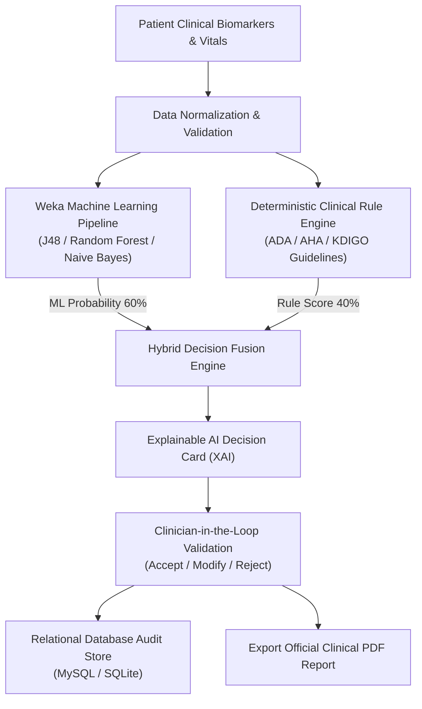
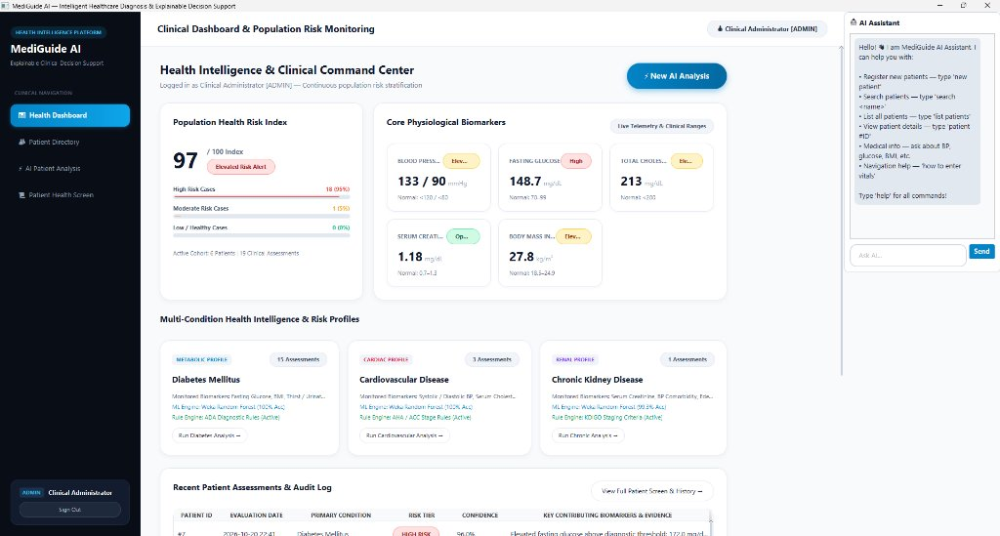
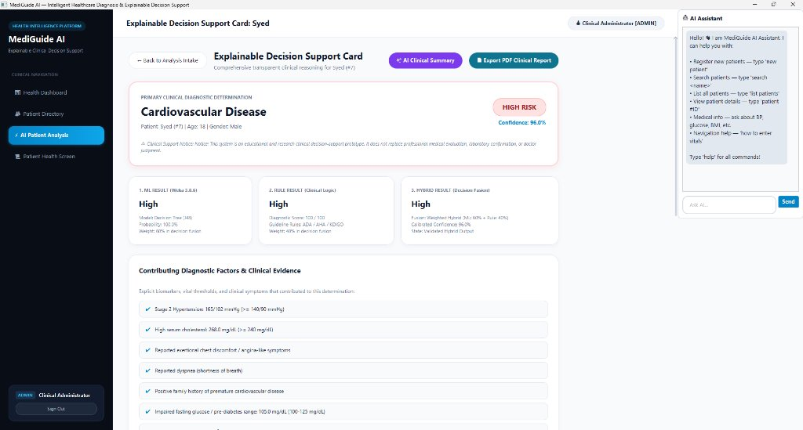
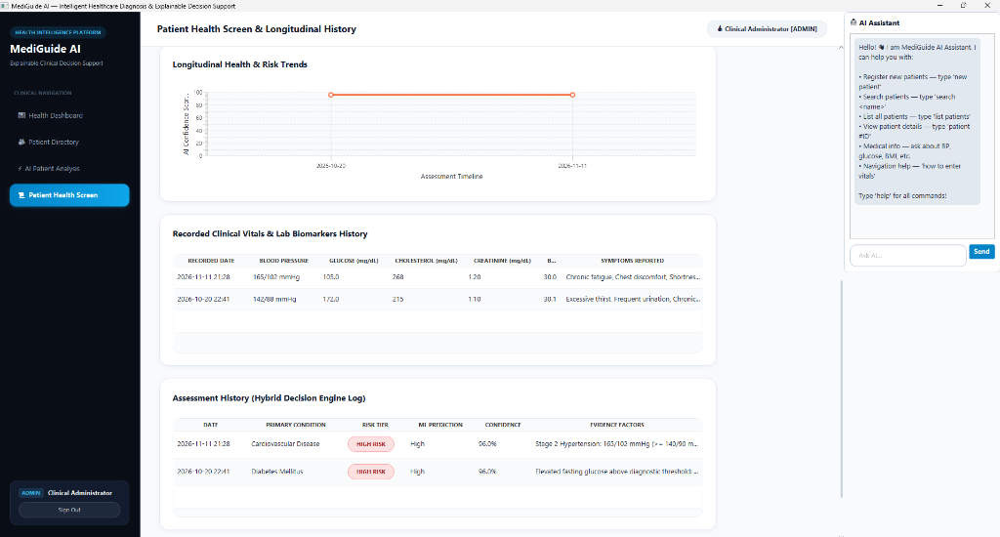

# 🏥 MediGuide AI — Explainable Hybrid AI Healthcare Decision Support System

[](https://www.oracle.com/java/)
[](https://openjfx.io/)
[](https://www.mysql.com/)
[](https://www.cs.waikato.ac.nz/ml/weka/)
[](https://itextpdf.com/)
[]()
[](LICENSE)

> **MediGuide AI** is an advanced **Explainable AI (XAI)** Clinical Decision Support System (CDSS) built in **Java 21** and **JavaFX**. It combines **Weka Machine Learning algorithms** (*J48 Decision Tree, Random Forest, Naive Bayes* with 10-fold cross validation) and a **Deterministic Clinical Rule Engine** into a transparent, **weighted hybrid decision fusion architecture**.

---

## 📑 Table of Contents
1. [Project Overview & Problem Statement](#1-project-overview--problem-statement)
2. [System Architecture & Hybrid Fusion Flow](#2-system-architecture--hybrid-fusion-flow)
3. [Explainable AI (XAI) & Biomarker Thresholds](#3-explainable-ai-xai--biomarker-thresholds)
4. [Database Design & Schema (`Database.sql`)](#4-database-design--schema-databasesql)
5. [Required libraries and dependencies.](#5-required-libraries-and-dependencies)
6. [All implemented modules and functionalities](#6-all-implemented-modules-and-functionalities)
7. [Application Output & UI Showcase (`output/`)](#7-application-output--ui-showcase-output)
8. [Prerequisites](#8-prerequisites)
9. [Installation & Execution Guide](#9-installation--execution-guide)
10. [Demo Credentials](#10-demo-credentials)
11. [Repository Structure](#11-repository-structure)
12. [Automated Testing Suite](#12-automated-testing-suite)
13. [Clinical Disclaimer & License](#13-clinical-disclaimer--license)

---

## 1. Project Overview & Problem Statement

Modern healthcare decision support systems often rely either on pure rule-based expert heuristics (which lack statistical predictive nuance) or opaque deep neural networks ("black-box AI" which lack clinical interpretability and risk regulatory non-compliance).

**MediGuide AI resolves this dual bottleneck** by deploying a **Transparent Hybrid Decision Fusion Architecture**:
- **Statistical Machine Learning (60% Weight)**: Trains classifiers on clinical biomarker datasets to output multi-condition risk probabilities.
- **Deterministic Clinical Rules (40% Weight)**: Evaluates evidence-based clinical practice guidelines (ADA, AHA, KDIGO) to produce verifiable biomarker factor checklists.
- **Clinician-in-the-Loop Oversight**: Empowers physicians to accept, modify, or reject algorithmic recommendations while logging an immutable audit trail.

---

## 2. System Architecture & Hybrid Fusion Flow



---

## 3. Explainable AI (XAI) & Biomarker Thresholds

MediGuide AI provides explicit clinical factor attribution answering *"Why did the system reach this conclusion?"*:

| Clinical Condition | Primary Biomarkers | Diagnostic Criteria & Standards |
|---|---|---|
| **Diabetes Mellitus** | Fasting Glucose, BMI, Thirst, Polyuria | American Diabetes Association (ADA): Fasting Glucose $\ge 126\text{ mg/dL}$, $\text{BMI} \ge 25.0\text{ kg/m}^2$ |
| **Cardiovascular Disease** | Systolic/Diastolic BP, Serum Cholesterol | American Heart Association (AHA/ACC): $\text{BP} \ge 140/90\text{ mmHg}$, $\text{Total Cholesterol} \ge 200\text{ mg/dL}$ |
| **Chronic Kidney Disease** | Serum Creatinine, Edema, Chronic HTN | KDIGO Guidelines: $\text{Creatinine} \ge 1.3\text{ mg/dL}$ (Male) / $\ge 1.1\text{ mg/dL}$ (Female) |

---

## 4. Database Design & Schema (`Database.sql`)

The repository includes a standalone SQL dump file: [`Database.sql`](Database.sql).

### Database Entities & Schema
- `users`: Authentication records, encrypted credentials, full names, roles (`ADMIN`, `DOCTOR`).
- `patients`: Demographics, contact info, medical history notes, creation timestamps.
- `medical_records`: Quantitative patient vitals (Systolic, Diastolic, Glucose, Cholesterol, Creatinine, BMI, Symptoms, Family History).
- `predictions`: Hybrid AI diagnostic outcomes, risk levels, confidence scores, ML probabilities, rule points, contributing factor strings, alternative hypotheses.
- `doctor_feedback`: Clinician validation decisions (`Accepted`, `Modified`, `Rejected`), physician comments, doctor IDs.
- `model_results`: Historical ML algorithm evaluation metrics (Accuracy, Precision, Recall, F1-Score).

### Database Setup Instructions

#### Option A: MySQL Server 8.0+ (Recommended)
Import [`Database.sql`](Database.sql) using the command line:
```bash
mysql -u root -p < Database.sql
```
Or in **MySQL Workbench**:
1. Open **File &rarr; Open SQL Script...** &rarr; select [`Database.sql`](Database.sql).
2. Click the ⚡ **Execute** icon.

Configure connection parameters in `src/main/resources/db.properties`:
```properties
db.type=mysql
db.mysql.host=localhost
db.mysql.port=3306
db.mysql.database=mediguide_ai
db.mysql.username=root
db.mysql.password=YOUR_PASSWORD
```

#### Option B: Embedded SQLite (Zero Configuration)
Set `db.type=sqlite` in `src/main/resources/db.properties` to utilize the included standalone SQLite database (`mediguide.db`) without running a database server.

---

## 5. Required libraries and dependencies.

The system is constructed using modern Java 21 LTS and managed with Apache Maven. The table below lists all required libraries, dependencies, versions, and their roles:

| # | Library / Dependency | Artifact Identifier | Version | Functional Role & Architecture Scope |
|---|---|---|---|---|
| **1** | **JavaFX Controls** | `org.openjfx:javafx-controls` | `21.0.2` | Core desktop UI widgets, buttons, input fields, tables, scroll panes, and modal dialogs. |
| **2** | **JavaFX FXML** | `org.openjfx:javafx-fxml` | `21.0.2` | FXML markup parser and controller lifecycle binding for modular view layouts. |
| **3** | **JavaFX Graphics** | `org.openjfx:javafx-graphics` | `21.0.2` | Hardware-accelerated 2D scene graph rendering engine, stage management, and canvas painting. |
| **4** | **Weka Machine Learning Library** | `nz.ac.waikato.cms.weka:weka-stable` | `3.8.6` | Core predictive modeling engine: Decision Tree (J48), Random Forest, Naive Bayes, ARFF dataset handling, 10-fold cross-validation, and class probability distribution calculations. |
| **5** | **iTextPDF** | `com.itextpdf:itextpdf` | `5.5.13.3` | PDF document rendering engine for generating official clinical diagnostic summary reports with embedded tables, risk badges, and audit signatures. |
| **6** | **MySQL Connector/J** | `com.mysql:mysql-connector-j` | `8.3.0` | Official Type-4 JDBC driver establishing relational database communication with MySQL Server 8.0+. |
| **7** | **SQLite JDBC** | `org.xerial:sqlite-jdbc` | `3.45.1.0` | Embedded zero-setup SQL database engine driver for offline and standalone execution (`mediguide.db`). |
| **8** | **JUnit 5 Jupiter API** | `org.junit.jupiter:junit-jupiter-api` | `5.10.2` | Automated testing framework for unit and regression testing of ML models, rule engines, and DAOs. |
| **9** | **JUnit 5 Jupiter Engine** | `org.junit.jupiter:junit-jupiter-engine` | `5.10.2` | Test execution runtime engine integrated into the Maven build lifecycle. |
| **10** | **Maven Compiler Plugin** | `org.apache.maven.plugins:maven-compiler-plugin` | `3.13.0` | Java 21 bytecode compiler plugin configured with strict `-Xlint:all` code quality checks. |
| **11** | **Maven Surefire Plugin** | `org.apache.maven.plugins:maven-surefire-plugin` | `3.2.5` | Automated test runner executing unit test suites during build verification. |
| **12** | **JavaFX Maven Plugin** | `org.openjfx:javafx-maven-plugin` | `0.0.8` | Execution plugin enabling cross-platform one-command application launching (`mvn javafx:run`). |

---

## 6. All implemented modules and functionalities

MediGuide AI is architected into cohesive, decoupled modules spanning the presentation, decision, data, and machine learning layers:

### 1. Authentication & Role-Based Access Control (RBAC) Module
- **Package / Classes**: [`com.mediguide.ui.LoginView`](src/main/java/com/mediguide/ui/LoginView.java), [`com.mediguide.models.User`](src/main/java/com/mediguide/models/User.java), [`com.mediguide.dao.UserDAO`](src/main/java/com/mediguide/dao/UserDAO.java)
- **Key Functionalities**:
  - Secure credential authentication against relational database tables.
  - Role-based UI partitioning: **System Administrator** (system analytics, settings, full CRUD) vs. **Medical Clinician** (patient vitals intake, diagnostic card, feedback).
  - Quick-fill preset buttons for frictionless demo evaluation.
  - Active session tracking and secure logout lifecycle.

### 2. Patient Registry & Demographics Management Module
- **Package / Classes**: [`com.mediguide.ui.PatientManagementView`](src/main/java/com/mediguide/ui/PatientManagementView.java), [`com.mediguide.models.Patient`](src/main/java/com/mediguide/models/Patient.java), [`com.mediguide.dao.PatientDAO`](src/main/java/com/mediguide/dao/PatientDAO.java)
- **Key Functionalities**:
  - Complete CRUD operations: register new patients, update details, search, and delete records.
  - Live real-time search filtering across patient names, phone numbers, and emails.
  - Patient detail inspection modal showing past clinical notes and background history.
  - Direct action routing: 1-click launch into **AI Diagnostic Intake** or **Patient Health History**.

### 3. Clinical Vitals Intake & Automated Preprocessing Module
- **Package / Classes**: [`com.mediguide.ui.MedicalDataEntryView`](src/main/java/com/mediguide/ui/MedicalDataEntryView.java), [`com.mediguide.models.MedicalRecord`](src/main/java/com/mediguide/models/MedicalRecord.java), [`com.mediguide.dao.MedicalRecordDAO`](src/main/java/com/mediguide/dao/MedicalRecordDAO.java)
- **Key Functionalities**:
  - Structured entry of clinical vitals: Systolic & Diastolic BP, Fasting Blood Glucose, Total Cholesterol, and Serum Creatinine.
  - Real-time automatic BMI calculator ($\text{weight (kg)} / \text{height (m)}^2$) with live visual category feedback (Underweight, Normal, Overweight, Obese).
  - Symptom checklist selection (Polyuria, Polydipsia, Exertional Dyspnea, Chest Tightness, Peripheral Edema, Fatigue).
  - Input boundary validation preventing physiologically invalid clinical inputs.

### 4. Machine Learning Predictive Pipeline (Weka ML) Module
- **Package / Classes**: [`com.mediguide.ml.WekaMLService`](src/main/java/com/mediguide/ml/WekaMLService.java), [`com.mediguide.ml.DatasetGenerator`](src/main/java/com/mediguide/ml/DatasetGenerator.java), [`com.mediguide.models.ModelEvaluationResult`](src/main/java/com/mediguide/models/ModelEvaluationResult.java)
- **Key Functionalities**:
  - Educational ARFF dataset generation: `diabetes_risk.arff`, `heart_disease_risk.arff`, and `kidney_disease_risk.arff`.
  - Multi-classifier training and model persistence (`.model` serialization):
    - **J48 Decision Tree (C4.5)**: Rule-extractable hierarchical tree structure.
    - **Random Forest**: Multi-tree bagging ensemble for resilient predictions.
    - **Naive Bayes**: Fast probabilistic classifier based on Bayes' Theorem.
  - Rigorous 10-Fold Stratified Cross-Validation computing real metrics: Accuracy, Precision, Recall, and F1-Score.
  - Multi-class probability distribution estimation (`distributionForInstance`).

### 5. Deterministic Clinical Rule Engine Module
- **Package / Classes**: [`com.mediguide.engine.RuleEngine`](src/main/java/com/mediguide/engine/RuleEngine.java), [`com.mediguide.engine.RiskCalculator`](src/main/java/com/mediguide/engine/RiskCalculator.java), [`com.mediguide.engine.DecisionEngine`](src/main/java/com/mediguide/engine/DecisionEngine.java)
- **Key Functionalities**:
  - Implements standardized medical guidelines:
    - **ADA Guidelines** for Type 2 Diabetes Mellitus screening.
    - **AHA/ACC Standards** for Stage 1/2 Hypertension and Dyslipidemia.
    - **KDIGO Criteria** for Chronic Kidney Disease biomarker stratification.
  - Deterministic risk scoring combining biomarker thresholds and reported clinical symptoms.
  - Generates transparent evidence statements for every active rule condition.

### 6. Hybrid Decision Fusion Engine Module
- **Package / Classes**: [`com.mediguide.engine.DecisionFusionService`](src/main/java/com/mediguide/engine/DecisionFusionService.java), [`com.mediguide.models.RiskAssessmentResult`](src/main/java/com/mediguide/models/RiskAssessmentResult.java)
- **Key Functionalities**:
  - Synthesizes probabilistic ML outputs (60% weight) with deterministic rule outcomes (40% weight).
  - Dynamic weight adjustment support (configurable live through System Settings).
  - Graceful fallback: automatically falls back to rule-based evaluation if ML models are uninitialized or missing.
  - Simultaneous multi-condition screening for Diabetes, Cardiovascular Disease, and Chronic Kidney Disease.

### 7. Explainable AI (XAI) & Clinical Decision Card Module
- **Package / Classes**: [`com.mediguide.engine.ExplanationGenerator`](src/main/java/com/mediguide/engine/ExplanationGenerator.java), [`com.mediguide.ui.ExplainableResultView`](src/main/java/com/mediguide/ui/ExplainableResultView.java)
- **Key Functionalities**:
  - Transparent evidence breakdown answering *"Why did the system reach this conclusion?"*.
  - Biomarker threshold comparison table contrasting patient values against normal reference intervals.
  - Differential diagnostic hypothesis engine suggesting secondary conditions and co-morbidities.
  - Actionable clinical next steps (e.g., recommend HbA1c testing, ECG, or nephrology referral).

### 8. Clinician-in-the-Loop Oversight & Validation Module
- **Package / Classes**: [`com.mediguide.dao.DoctorFeedbackDAO`](src/main/java/com/mediguide/dao/DoctorFeedbackDAO.java), [`com.mediguide.models.DoctorFeedback`](src/main/java/com/mediguide/models/DoctorFeedback.java)
- **Key Functionalities**:
  - Three-way physician validation mechanism: **Accept**, **Modify**, or **Reject** the AI decision.
  - Physician clinical notes and reasoning capture.
  - Immutable audit trail linking doctor decisions directly to patient prediction records.

### 9. Patient Health History & Longitudinal Tracking Module
- **Package / Classes**: [`com.mediguide.ui.PatientHistoryView`](src/main/java/com/mediguide/ui/PatientHistoryView.java), [`com.mediguide.dao.PredictionDAO`](src/main/java/com/mediguide/dao/PredictionDAO.java)
- **Key Functionalities**:
  - Chronological timeline of all historical diagnostic screenings and vital measurements.
  - Longitudinal risk trajectory line charts visualizing patient risk progression over time.
  - Quick-action buttons to generate updated PDF reports or initiate immediate follow-up intake.

### 10. Population Health Dashboard & Cohort Analytics Module
- **Package / Classes**: [`com.mediguide.ui.DashboardView`](src/main/java/com/mediguide/ui/DashboardView.java)
- **Key Functionalities**:
  - Real-time KPI summary metric cards (Total Patients, High-Risk Alerts, Pending Reviews, Total Records).
  - Population risk distribution visual pie charts.
  - Multi-disease prevalence comparative bar charts.
  - Interactive Weka ML algorithm benchmark charts comparing Accuracy, Precision, Recall, and F1 across algorithms.

### 11. Conversational AI Clinical Assistant Module
- **Package / Classes**: [`com.mediguide.ai.MediGuideChatEngine`](src/main/java/com/mediguide/ai/MediGuideChatEngine.java), [`com.mediguide.ui.ChatbotPanel`](src/main/java/com/mediguide/ui/ChatbotPanel.java)
- **Key Functionalities**:
  - Embedded slide-out conversational AI panel accessible from any screen.
  - Domain-specific medical knowledge base covering biomarker explanations, clinical guidelines, and lifestyle recommendations.
  - Contextual handoff: 1-click transfer of patient diagnostic findings into the chatbot for interactive exploration.

### 12. Official Clinical PDF Report Generation Module
- **Package / Classes**: [`com.mediguide.util.PdfReportGenerator`](src/main/java/com/mediguide/util/PdfReportGenerator.java)
- **Key Functionalities**:
  - 1-Click export of formatted clinical summary documents matching medical hospital standards.
  - Embedded clinic branding header, patient demographic box, quantitative vitals table, hybrid risk breakdown, physician review notes, and clinical disclaimer.

### 13. Dual Relational Database Management Module
- **Package / Classes**: [`com.mediguide.database.DatabaseManager`](src/main/java/com/mediguide/database/DatabaseManager.java), [`Database.sql`](Database.sql)
- **Key Functionalities**:
  - Dynamic dual-mode connection pooling (MySQL 8.0 or embedded SQLite).
  - Automated table creation, schema verification, and non-destructive column migrations.
  - Foreign key cascading deletes maintaining database referential integrity.
  - Complete SQL seed file [`Database.sql`](Database.sql) for reproducible system setup.

---

## 7. Application Output & UI Showcase (`output/`)

All system execution output and workflow screens are saved in the [`output/`](output/) folder:

| Screen # | Module / Workflow Screen | Description |
|---|---|---|
| **01** | **Authentication Portal** | Role-based authentication supporting Administrator and Doctor logins with quick-fill demo presets. |
| **02** | **Clinical Health Command Dashboard** | Real-time population risk index, biomarker telemetry, multi-condition profiles, and audit log. |
| **03** | **Patient Diagnostic Intake** | Quantitative vitals entry (BP, glucose, cholesterol, creatinine), automatic BMI computation, and clinical symptoms checklist. |
| **04** | **Explainable AI (XAI) Decision Card** | Fused hybrid risk determination (Cardiovascular / Diabetes / CKD) with contributing biomarker evidence. |
| **05** | **Differential Hypotheses & Clinician Feedback** | Secondary etiology considerations, guideline-directed protocols, and clinician override form. |
| **06** | **Patient Health Profile & Telemetry** | Complete patient demographic profile, biomarker cards, and historical diagnosis breakdown. |
| **07** | **Longitudinal Health & Risk Trajectories** | Interactive JavaFX risk progression chart and audit log of clinical vitals across time. |

<p align="center">
  
</p>
<p align="center">
  
</p>
<p align="center">
  
</p>

---

## 8. Prerequisites

Before running the application, ensure your environment meets these requirements:
- **Operating System**: Windows 10/11, macOS 12+, or Ubuntu 20.04+ LTS
- **Java Development Kit (JDK)**: Version 21 LTS or later
- **Apache Maven**: Version 3.8+ (included via `./mvnw` / `.\mvnw.cmd`)
- **MySQL Server 8.0+** (optional; SQLite works out-of-the-box)

---

## 9. Installation & Execution Guide

### Step 1: Clone the Repository
```bash
git clone https://github.com/syedameencode/MediGuideAI.git
cd MediGuideAI
```

### Step 2: Database Initialization (Optional for MySQL)
If using MySQL, import [`Database.sql`](Database.sql):
```bash
mysql -u root -p < Database.sql
```
*(If using SQLite, skip this step — the database initializes automatically).*

### Step 3: Run the Application
Using the 1-click Windows batch script:
```powershell
.\run.bat
```
Or using the Maven wrapper:

**Windows (PowerShell):**
```powershell
.\mvnw.cmd javafx:run
```

**Linux / macOS:**
```bash
./mvnw javafx:run
```

### Step 4: Run Automated Tests
```powershell
.\mvnw.cmd test
```

---

## 10. Demo Credentials

Quick-fill buttons are provided on the login view:

| Role | Username | Password | Access Privileges |
|---|---|---|---|
| **System Administrator** | `admin` | `admin123` | Patient Directory CRUD, System Settings, ML Retraining & Population Analytics |
| **Medical Clinician** | `doctor` | `doctor123` | Patient Diagnostic Intake, Explainable AI Cards & Physician Overrides |

---

## 11. Repository Structure

```text
MediGuideAI/
├── Database.sql                    # MySQL schema & pre-seeded clinical cohort datasets
├── README.md                       # Comprehensive system documentation
├── LICENSE                         # MIT open-source license
├── run.bat                         # 1-Click Windows execution script
├── pom.xml                         # Maven dependencies & build configurations
├── mvnw / mvnw.cmd                 # Maven wrapper scripts
├── mediguide.db                    # Embedded SQLite database fallback
├── output/                         # Application output screenshots & UI workflow
│   ├── 01_login_screen.png
│   ├── 02_clinical_dashboard.jpg
│   ├── 03_patient_diagnostic_intake.png
│   ├── 04_explainable_ai_decision_card.jpg
│   ├── 05_differential_diagnosis_and_feedback.jpg
│   ├── 06_patient_health_profile.jpg
│   └── 07_longitudinal_risk_trends.png
├── ml_datasets/                    # Educational ARFF datasets (Weka)
│   ├── diabetes_risk.arff
│   ├── heart_disease_risk.arff
│   └── kidney_disease_risk.arff
├── ml_models/                      # Serialized Weka machine learning models (.model)
└── src/
    ├── main/
    │   ├── java/com/mediguide/
    │   │   ├── AppLauncher.java    # Application entry point
    │   │   ├── MainApp.java        # JavaFX stage lifecycle & scene routing
    │   │   ├── ai/                 # Clinical chatbot triage assistant
    │   │   ├── dao/                # Data Access Objects (User, Patient, MedicalRecord, etc.)
    │   │   ├── database/           # Dual MySQL/SQLite connection manager & migrations
    │   │   ├── engine/             # Decision fusion, clinical rules & XAI explanations
    │   │   ├── ml/                 # Weka ML training, evaluation & dataset generation
    │   │   ├── models/             # Domain POJOs & risk assessment data structures
    │   │   ├── ui/                 # Modern JavaFX views & dashboards
    │   │   └── util/               # PDF report generator & theming
    │   └── resources/
    │       ├── db.properties       # Database configuration (MySQL / SQLite switch)
    │       └── styles.css          # Modern dark/light medical dashboard styling
    └── test/java/com/mediguide/    # Automated unit & integration tests
```

---

## 12. Automated Testing Suite

The project includes an automated JUnit 5 test suite verifying system correctness:
- `WekaMLServiceTest`: Validates ARFF dataset generation, model training, cross-validation metrics, and probability predictions.
- `DecisionFusionServiceTest`: Tests hybrid ML (60%) + Rule (40%) decision fusion, fallback logic, and dynamic weight tuning.
- `PdfReportGeneratorTest`: Verifies PDF report file creation and structural layout.
- `DatabaseManagerTest`: Tests SQLite/MySQL connection, table initialization, and CRUD operations.
- `DecisionEngineTest`: Tests rule-based thresholds and multi-condition evaluations.

---

## 13. Clinical Disclaimer & License

### Clinical Disclaimer
**IMPORTANT NOTICE**: MediGuide AI is designed solely for educational, academic, and clinical research demonstration purposes. It does not constitute certified medical diagnostic equipment or licensed medical advice. All algorithmic outputs and recommendations must be reviewed and validated by a licensed physician or certified medical authority before administering patient care or prescribing treatment.

### License
This project is open-source under the terms of the [MIT License](LICENSE).
